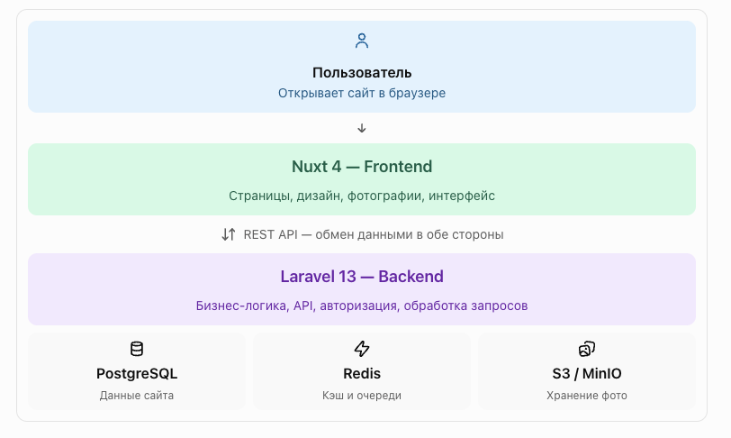

# &#127757; CityGuide — Путеводитель по городам 

Современный веб-сервис-путеводитель по городам мира.

CiteGuide позволяет пользователям находить города, изучать фотографии, достопримечательности, интересные места и готовые туристические маршруты.

---

# &#128204; 1. О проекте

Основная идея проекта - создать современный путеводитель по городам мира.

## 2. Пользователь сможет

- искать города и достопримечательности;
- изучать города; 
- смотреть фотографии;
- смотреть обьекты на карте;
- изучать достопримечательности;
- просматривать туристические маршруты;
- добавлять места в избранное;
- создавать собственные подборки; 
- оставлять отзывы.

Основной акцент интерфейса - фотографии, удобная навигация и SEO (Search Engine Optimization).

---

# &#128736; 3. Технологический стэк

## Backend 

- PHP 8.5 
- Laravel 13 
- Postgres SQL 18
- Redis 8
- Laravel Sanctum 4
- Laravel Scout 11
- Laravel Storage 

## Frontend

- Nuxt 4
- Vue 3 
- TypeScript 7
- Tailwind CSS 4
- Vite 8

## Infrastructure

- Docker
- Docker Compose
- Nginx
- PostgresSQL
- Redis
- MinIO 
- S3-compatible storage

---

# &#128736; 4. Архитектура



# 5. Пользоватеьская часть

## 5.1 Главная страница

Главная страница должна содержать следущее: 

### Hero-блок

- Большая фотография
- Главное назвние проекта
- Краткое и емкое описание проекта
- Поиск городов
- Кнопка к переходу другим городам
...

Пример: 
    Открой мир по-новому
    Путеводитель по городам, местам и маршрутам

### Популярные города 

Карточки городов:
- фотография; 
- название; 
- страна;
- краткое описание; 
- количество достопримечательностей;

**Функционал в будущем:**
- Популярные наравления
- Популярные места

# 6. Города

## 6.1 Католог городов

Пользователь может:

- просматривать список городов;
- искать город;
- фильтровать по стране;
- сортировать города;
- открывать страницу города;
...

# 7. Страница города

URL: 
    /cities/{slug}

Пример:

    /cities/moscow
    /cities/paris
    /cities/tokyo
    /cities/istanbul

##  Основная информация

- название 
- страна
- регион
- фотографию 
- галерею 
- краткое описание 
- полное описание

**Функционал в будущем:**
- Информация для путишественника 
- Достопримичательности
- Маршруты
- Карта

# 8. Достопримечательности

URL: 
    /places/{slug}

Пример: 
    /places/eiffel-tower

Страница достопримичательности:
- название
- фотографии
- описание
- город
- страна
...

# 9. Фотографии 

Фотографии являются одной из основных частей проекта.
Каждый обьект может иметь несколько фотографий.
Фотографии будут интуитивные для взаимодействия пользователя.

Для **production** - будем орентироваться на S3-совместимое хранилище.
Для **локальной** разработки - MinIO

# 10. Маршруты

**Функционал в будущем:**

Маршруты для прогулок и путешествий
Предоставляются с четкими локациями и временым диапазоном

## Маршруты должен содержать
- название 
- описание 
- город 
- продолжительность
- расстояние
- фотографии
- список мест 
- порядок посящения
- приблизительное время
- рекомендации 

# 11. Поиск 

Необходимо реализовать глобальный поиск.

Поиск должен находить: 
- города 
- страны
- достопримечательности
- маршруты

Backend использует:
- Laravel Scout

# 12. Карты

Для отображения мест использовать картографический сервис.

llatitude 
longitude

Будем изображать на карте все знаковые места и локации.

# 13. Пользовательская система

Регистрация пользователя: 
- email
- пароль 
- имя 
- аватар

Авторизация: 
**Laravel Sanctum**

**Функционал в будущем:**
Пользователь может:
- редактировать профиль 
- добавлять места в избранное 
- сохранять маршруты
- создавать подборки
- оставлять отзывы 
- оценивать места 

# 14. Избранное 
**Функционал в будущем**
Пользователь может добавить:
- город 
- достопримечательность
- маршрут

Раздел:
/profile/favorites

# 15. Подборки

**Функционал в будущем**

Пользователь может создать собственную подборку.

Пример: 
    Моя поездка в Париж 

    - Эйфелева башня
    - Лувр
    - Монмартр
    - Версаль

    Подборка может быть:
    - приватной 
    - публичной 

# 16. Отзывы 

**Функционал в будущем**

Пользователь может оставить отзыв о месте.

Отзыв содержит:
- текст 
- оценку звезд
- фотографии
- дату 
- пользователя, может отметить, чтобы анонимно

Предусмотреть модерацию отзывов

# 17. Административная панель

Административная часть необходима для управления контентом. 

Администратор может управлять:
- странами 
- городами 
- достопримечательностями
- фотографиями
- категориями 
- маршрутами
- пользователями 
- отзывами 
- подборками

# 18. Управление городом 

Форма создания города:

Название 
Slug - URL наименование в строке 
Страна
Регион 
Краткое описание
Полное описание 
Главная фотография 
Галерея
Население
Часовой пояс
Валюта
Язык 
Координаты
SEO Title
SEO Description 

# 19. Управление достопримечательностью

Форма создания достопримечательности:

Название
Slug - URL наименование в строке 
Город 
Категория 
Краткое описание 
Полное описание 
Фотографии 
Адрес 
Latitude
Longitude
Время работы
Стоимость
Офицальный сайт 
SEO Title 
SEO Description

# 20. SEO 

**Функционал в будущем**

SEO является одной из основных задач проекта.

Каждый город должен иметь отдельную индексируемую страницу. 

Пример: 
/cities/paris

Реализовать:
- SSR
- Meta Title 
- Meta Drscription
- Open Graph
- Twitter Cards 
- canonical URL
- sitemap.xml
- robots.txt
- structured data
- человекочитаемые URL 
- оптимизацию изображений 
- alt-тексты 

Для города желательно использовать Schema.org
City
TouristAttraction 
Article
BreadcrumbList


# 21. Производительность

Основные требования:
- SSR для публичных страниц
- кеширования часто используемых данных 
- оптимизация изображений
- WebP / AVIF
- lazy loading 
- CDN для изображений 
- Redis cache 
- пагинация 
- оптимизация SQL-запросов 
- отсутствие N+1 запросов

# 22. API 

Laravel предоставляет REST API.

Основные группы:

/api/countries
/api/cities
/api/places
/api/routes 
/api/categories
/api/auth
/api/users
/api/favorites 
/api/collections
/api/reviews

Пример:
GET /api/cities/paris

Ответ:
```json
}
    "id": 1,
    "name": "Париж", 
    "slug": "paris",
    "country": {
        "id": 1,
        "name": "Франция"
    }, 
    "description": "...",
    "cover": "...",
    "places_count": 124
}
```
# 23. База данных 

Основные таблицы: 

```json
    users

    countries
    regions
    cities

    categories
    places
    places_photos

    city_photos

    routes
    route_places

    favorites
    collections
    collection_items

    reviews

    tags
    place_tags
    city_tags

    media
```


## География и привязка к локациям

- countries ➔ regions: Одна страна содержит много регионов (один-ко-многим).
- countries ➔ cities: Одна страна содержит много городов (один-ко-многим).
- regions ➔ cities: Один регион содержит много городов (один-ко-многим).
- cities ➔ places: В одном городе находится много мест/достопримечательностей (один-ко-многим).
- cities ➔ routes: В одном городе берет начало или проходит много маршрутов (один-ко-многим).
- cities ➔ city_photos: У одного города может быть много фотографий (один-ко-многим).

### Структура Места (Places)

- categories ➔ places: Одна категория объединяет много мест (один-ко-многим).
- places ➔ place_photos: У одного места может быть много фотографий (один-ко-многим).
- places ➔ reviews: Одно место может иметь много отзывов от разных пользователей (один-ко-многим).
- places ➔ place_tags ➔ tags: Места связаны с тегами «многие-ко-многим» через связующую таблицу place_tags.
- cities ➔ city_tags ➔ tags: Города связаны с тегами «многие-ко-многим» через связующую таблицу city_tags.

### Структура Маршрута (Routes)

- routes ➔ route_places ➔ places: Маршруты связаны с местами «многие-ко-многим» через связующую таблицу route_places (один маршрут состоит из многих мест, одно место может быть во многих маршрутах).

### Пользовательский контент (Users)

- users ➔ reviews: Один пользователь может написать много отзывов (один-ко-многим).
- users ➔ collections: Один пользователь может создать много своих подборок/коллекций (один-ко-многим).
- users ➔ favorites: Один пользователь может добавить много сущностей в избранное (один-ко-многим).

### Коллекции и Избранное

- collections ➔ collection_items ➔ places / routes: Коллекции связаны с элементами (местами или маршрутами) «многие-ко-многим» через связующую таблицу collection_items.
- favorites ➔ places / routes: Избранное связывает пользователя с конкретным местом или маршрутом.

### Централизованные медиа

- media ➔ place_photos / city_photos: Главная таблица медиафайлов хранит исходные файлы, на которые ссылаются таблицы фотографий мест и городов.

Country
    └── Regions
    └── Cities
    ├── Places
    ├── Routes
    └── City_photos
City
    └── City_tags
    └── Tags
Place
    ├── Place_photos
    ├── Categories (Категория места)
    ├── Reviews (Отзывы пользователей)
    └── Place_tags
    └── Tags
Route
    └── Route_places
    └── Places
User
    ├── Reviews (Написанные пользователем)
    ├── Favorites (Избранные места и маршруты)
    └── Collections (Созданные папки/подборки)
    └── Collection_items
    ├── Places
    └── Routes
Media
    ├── Place_photos (Исходные файлы для фото мест)
    └── City_photos (Исходные файлы для фото городов)

# 24. Роли пользователей

Минимально начальная разработка.

admin 
editor
user

Admin 
Полный доступ к данным и настройкам

Editor (возможно в разработке внедрим)

Может: 
- создавать города 
- редактировать города 
- создавать места
- редактировать места
- управлять фотографиями
- управлять маршрутами 

User 

Может:
- просматривать контент 
- добавлять избранное
- создавать подборки 
- оставлять отзывы

# 25.Дизайн

Основной стиль:

- современый
- минималистичный
- туристический
- большое количество фотографий
- крупная типографика 
- плавная анимация
- адаптивность

Основной акцент - фотографии, но будет обсуждаться

Необходимо избегать перегруженного интерфейса 

# 26. Адаптивность

Сайт должен работать корректно 

Desktop
Tablet 
Mobile

Основные страницы должны быть полностью адаптивными 

# 27 Docker 

Локальная разработка должна запускаться через Docker

Контейнеры: 
frontend 
backend 
postgres 
redis
minio
nginx

```json
docker compose up -d
```

# 28. Окружение

Необходимо предусмотреть: 

local
development
production

Конфигурации хранятся в .env

Секреты не должны падать в Git 

# 29 Git

Основная ветка
```json
main
```

Разработка 
```json 
develop
```

# 30. Этапы разработки 

...

# 31. MVP Minimum Vible Product

Первая версия проекта должна содержать только необходимый функционал

MVP версия 1.0 включает:

- главную страницу сайта
- страны
- города
- достопримечательности
- фотографии 
- поиск 
- страница города
- страница достопримечательности 
- карта
- административная панель
- SEO

Следущая версия:

- отзывы
- социальные функции
- подборки пользователей
- рекомендации 
- сложная и продуманная система маршрутов
- мобильное приложение для пользователей
- подписки и платные функции

**Будет обсуждаться**

# 32. Основной принцип разработки WEB APP

Проект должен разрабатываться таким 
образом, чтобы дальнейшее расширение 
функционала не требовало переписывания
основной архитектуры

Особое внимание уделить:
- чистому API 
- разделению ответственности
- масштабируемости 
- SEO браузеров
- производительности
- безопасности
- оптимизации изображений
- удобству администрирования

# 33. Будущие возможности

**Функционал в будущем**

В дальнейшем возможно добавить:

- AI планируемые путешествия
- персональные рекомендачии 
- прогноз погоды 
- авиаперелеты
- отели 
- рестораны
- общественый транспорт
- события города
- туристические карты
- мультиязычность
- монетизация
- реклама 
- партнерские программы
- приложения 

# 34. Целевая структура проекта

```json
city-guide/
│
├── backend/
│   ├── app/
│   ├── routes/
│   ├── database/
│   ├── config/
│   ├── tests/
│   └── Dockerfile
│
├── frontend/
│   ├── app/
│   ├── components/
│   ├── pages/
│   ├── composables/
│   ├── types/
│   └── nuxt.config.ts
│
├── docker/
│   ├── nginx/
│   ├── php/
│   └── postgres/
│
├── docker-compose.yml
├── .env.example
├── .gitignore
└── README.md 
```

# 35. Критерий готовности MVP

MVP считается готовым, если пользователь может:

1. Открыть сайт 
2. Найти город через поиск
3. Открыть страницу города 
4. Посмотреть фотографии 
5. Прочитать описание 
6. Посмотреть достопримечательности
7. Открыть страницу достопримечательности 
8. Посмотреть ее расположение на карте
9. Перейти между связаннвми городами и местами 
10. Найти страницы через поисковцю систему 

Администратор при этом должен иметь возможность полностью управлять контентом через административную панель